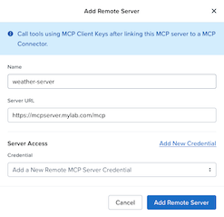
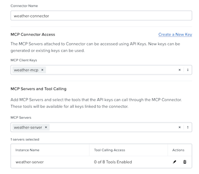
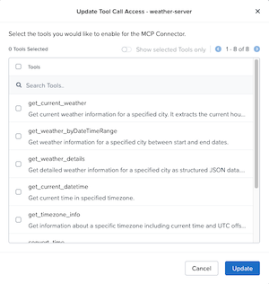
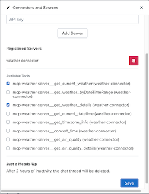
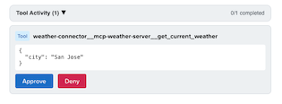
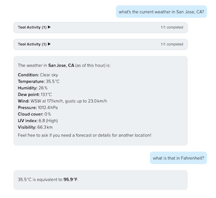
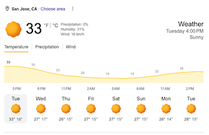
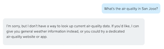
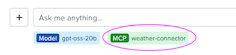
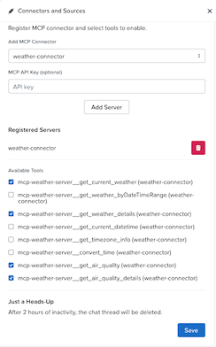

These are my notes on running and connecting a remote MCP Server to Nutanix Enterprise AI. We're just going to use a simple MCP server that provides weather information in order to test the functionality. Apologies in advance for the small images. I'll fix them some day.

## Versions used
* Nutanix Enterprise AI 2.7 with Agent Gateway
* [Weather MCP Server](https://mcpservers.org/servers/isdaniel/mcp_weather_server) v0.6.0

## Requirements
* Python 3.10+
* pip 22.0.2+
* FQDN name for the server with a CA-signed certificate

## Create VM to host the server
Specs:
- Ubuntu 22.04 or 24.04
- 2 vCPU, 4 GB RAM, 100GB disk

## Install MCP server as Python module

Since we want to run this as an HTTP server, we also need to install starlette (lightweight ASGI framework/toolkit) and uvicorn (ASGI web server).
```
pip install mcp_weather_server starlette uvicorn
```

## Run the HTTP server in Streamable HTTP mode

Quick note on the different types of transport options:

There are two standard ways to run MCP servers as defined by the [MCP specification](https://blog.modelcontextprotocol.io/posts/2025-12-19-mcp-transport-future/):

* STDIO (standard I/O) - for local deployments and development. Bypasses network protocols completely.
* Streamable HTTP - for remote and production deployments

You may have also heard of SSE (Server-Sent Events), which is an older HTTP-based transport technique allowing servers to stream data to clients continously, but is just one-way streaming. It has been succeeded by Streamable HTTP, which handles both incoming requests and outgoing event streams in a unified setup.

Let's run the HTTP server:

```
python -m mcp_weather_server --mode streamable-http
```

Sample output
```
nutanix@mcp-host:~$ python -m mcp_weather_server --mode streamable-http
INFO:mcp-weather:Registered tool handler: get_current_weather
INFO:mcp-weather:Registered tool handler: get_weather_byDateTimeRange
INFO:mcp-weather:Registered tool handler: get_weather_details
INFO:mcp-weather:Registered tool handler: get_current_datetime
INFO:mcp-weather:Registered tool handler: get_timezone_info
INFO:mcp-weather:Registered tool handler: convert_time
INFO:mcp-weather:Registered tool handler: get_air_quality
INFO:mcp-weather:Registered tool handler: get_air_quality_details
INFO:mcp-weather:Registered 8 tool handlers
INFO:mcp-weather:Starting MCP Weather Server in streamable-http mode...
INFO:mcp-weather:Python version: 3.10.12 (main, Aug 15 2025, 14:32:43) [GCC 11.4.0]
INFO:mcp-weather:Registered tools: ['get_current_weather', 'get_weather_byDateTimeRange', 'get_weather_details', 'get_current_datetime', 'get_timezone_info', 'convert_time', 'get_air_quality', 'get_air_quality_details']
INFO:mcp-weather:Starting Streamable HTTP server (stateful) on 0.0.0.0:8080...
INFO:mcp-weather:Endpoint: http://0.0.0.0:8080/mcp
INFO:     Started server process [5110]
INFO:     Waiting for application startup.
INFO:mcp.server.streamable_http_manager:StreamableHTTP session manager started
INFO:mcp-weather:Streamable HTTP session manager started!
INFO:     Application startup complete.
INFO:     Uvicorn running on http://0.0.0.0:8080 (Press CTRL+C to quit)
```
## Test the connection with curl

From another terminal window, you can test the connection with

```
curl -X POST http://localhost:8080/mcp \
  -H "Content-Type: application/json" \
  -H "Accept: application/json, text/event-stream" \
  -d '{ "jsonrpc": "2.0", "id": 1, "method": "initialize", "params": { "protocolVersion": "2024-11-05", "capabilities": {}, "clientInfo": { "name": "curl-test", "version": "1.0.0" } } }'
```

Also ensure it's accessible from the network Nutanix Enterprise AI is running on by replacing localhost with the host IP.

Successful output looks like:
```
event: message
data: {"jsonrpc":"2.0","id":1,"result":{"protocolVersion":"2024-11-05","capabilities":{"experimental":{},"tools":{"listChanged":false}},"serverInfo":{"name":"mcp-weather-server","version":"1.28.1"}}}
```

## Configure Nginx
Nutanix Enterprise AI requires remote MCP servers to have a valid DNS name and a CA-signed certificate.

We'll use Nginx to secure our MCP server with SSL for remote access.

### Install Nginx if required
```
sudo apt update
sudo apt install -y nginx
```

### Copy certificate and private key to standard directories
```
sudo cp /home/nutanix/fullchain.pem /etc/ssl/certs/mcp-fullchain.pem
sudo cp /home/nutanix/privkey.pem /etc/ssl/private/mcp-privkey.pem
```

### Set security permissions so Nginx can read them
```
sudo chmod 644 /etc/ssl/certs/mcp-fullchain.pem
sudo chmod 600 /etc/ssl/private/mcp-privkey.pem
```

### Create an Nginx configuration file

1. Create the file
```
sudo vi /etc/nginx/sites-available/mcp-server
```

2. Paste the configuration, changing server_name to match your FQDN
```
server {
    listen 443 ssl;
    server_name <FQDN>;

    # SSL Certificates
    ssl_certificate /etc/ssl/certs/mcp-fullchain.pem;
    ssl_certificate_key /etc/ssl/private/mcp-privkey.pem;

    # Strong TLS settings
    ssl_protocols TLSv1.2 TLSv1.3;
    ssl_ciphers HIGH:!aNULL:!MD5;

    location /mcp {
        proxy_pass http://127.0.0.1:8080/mcp;

        # Forwarding Headers
        proxy_http_version 1.1;
        proxy_set_header Connection "";
        proxy_set_header Host $host;
        proxy_set_header X-Real-IP $remote_addr;
        proxy_set_header X-Forwarded-For $proxy_add_x_forwarded_for;
        proxy_set_header X-Forwarded-Proto $scheme;

        # Streamable HTTP Streaming Settings
        proxy_buffering off;
        proxy_cache off;
        proxy_read_timeout 24h;
    }
}
```
3. Save and close the file.

### Enable the configuration and start Nginx
```
sudo ln -s /etc/nginx/sites-available/mcp-server /etc/nginx/sites-enabled/
```

### Verify remote connectivity

From a remote system, test the connection, replacing FQDN to match your environment

```
export FQDN_MCP_SERVER="mcp.myserver.com"
curl -X POST https://$FQDN_MCP_SERVER/mcp \
     -H "Content-Type: application/json" \
     -H "Accept: application/json, text/event-stream" \
     -d '{
       "jsonrpc": "2.0",
       "id": 1,
       "method": "initialize",
       "params": {
         "protocolVersion": "2024-11-05",
         "capabilities": {},
         "clientInfo": {
           "name": "curl-test",
           "version": "1.0.0"
         }
       }
     }'
```

Sample output:
```
event: message
data: {"jsonrpc":"2.0","id":1,"result":{"protocolVersion":"2024-11-05","capabilities":{"experimental":{},"tools":{"listChanged":false}},"serverInfo":{"name":"mcp-weather-server","version":"1.28.1"}}}
```

Once this is working, we're ready to move onto the next step of configuring NAI!

## Configure MCP Server in Nutanix Enterprise AI

### Add MCP Server
1. From the Nutanix Enterprise AI interface, navigate to **MCP Servers** on the left hand side.
2. Click on the **Servers** tab. We'll need to create the server, before we can create the connector.
3. Click on **Add Remote Server**. If the system already has a server configured, click the **Add MCP Server** drop-down at the top, then click **Add Remote Server**.
4. Under **Name**, enter a display name for the server.
5. Under **Server URL**, enter the server URL as `https://FQDN_MCP_SERVER/mcp` where FQDN_MCP_SERVER matches your environment.
6. Leave **Credential** blank, as our test server doesn't require authentication.
   
    

### Add MCP Connector
1. Click on the Connectors tab.
2. Specify a name for the connector under **Connector Name**
3. Under **MCP Connector Access**, create or select an existing MCP Client Key that can access this connector.
4. Under **MCP Servers and Tool Calling**, select the MCP server created in the previous step.

    

Under the tool calling access column, you should see 0 of 8 tools enabled. Let's specify the tools that are available to this connector.

1. Click the pencil icon next to the MCP server name.
2. Select one or more tools and click **Update**. If selecting all tools, you'll be prompted to confirm.
3. Once you've configured the servers and tools, click **Create MCP Connector**.

    

## Test the MCP Connector from NAI Labs

Now we can test the MCP connector from any MCP client with our MCP Client Key, or from NAI Labs.

### Configure NAI Labs
1. Click NAI Labs on the left hand-side.
2. Click **Agent**.
3. Click the **+** to the left of the input field and select **Models**.
4. Select an local or unified endpoint to use as the LLM endpoint and enter in the API key for that endpoint (this is different than the MCP Client Key), and click **Save**.
5. Click the **+** once more, and select **Connectors and Sources**.
6. Select the MCP Connector you just created and the MCP Client Key, and click **Add Server**.
7. All the available tools will be listed. Let's select `get_current_weather` and `get_weather_details`. Then click **Save**
  
    

### Test the model and MCP connector
1. Now you can ask a question about the current weather, e.g. "What's the current weather in San Jose?"
2. You'll be prompted to approve the tool (get_current_weather). Click **Approve**

    

    

  Which is more or less what Google weather is reporting.

  

<!-- ### Enable Additional Tools
1. Ask a question about the air quality and notice that it won't be able to get the data, since we didn't enable that tool. This is tool filtering in action.
  


2. Click on the green MCP connector underneath the chatbox to bring up the details.



3. Select the `get_air_quality` and `get_air_quality_details` tools, and click **Save**.



4. Now ask the same question again, and you should be prompted to approve the `get_air_quality` tool. Click **Approve**. -->

## Test the MCP Connector from an MCP Client

Instead of connecting directly to the MCP server, many organizations want to control access to MCP servers and available tools, which is exactly what Nutanix Enterprise AI enables. In this section, we'll connect a lightweight MCP client to both the MCP server directly and then through NAI, to understand the behavior and how tool filtering comes into play.

### Configure MCP Connector

Let's first configure our MCP Connector to reduce the number of tools available.

1. From the MCP Servers page, select the checkbox next to the MCP Connector and click **Actions > Edit**
2. Under **MCP Servers and Tool Calling**, click the pencil icon next to the MCP server name.
3. Ensure only `get_current_weather` and `get_weather_details` is checked, then click **Update**.

The **Tool Calling Access** column should now only show `2 of 8 Tools Enabled`

Click **Edit MCP Connector** to save the configuration.

### Download the MCP Client

We'll run a simple Python MCP client to connect to our server.

```
# Download script
wget https://raw.githubusercontent.com/lauramariel/lauramariel.github.io/refs/heads/main/scripts/mcp_client.py
```

### Connect client directly to MCP Server

Let's first configure the client to connect directly to our running MCP server.

```
# Update script with your hostname of the MCP server directly
sed -i "s/your-remote-domain.com/$FQDN_MCP_SERVER/g" mcp_client.py
```

Then we'll run the script.

```
# Run the script
python mcp_client.py
```

The output will look something like this, showing all 8 tools available.
```
--- Available Tools ---
• Tool: get_current_weather
• Tool: get_weather_byDateTimeRange
• Tool: get_weather_details
• Tool: get_current_datetime
• Tool: get_timezone_info
• Tool: convert_time
• Tool: get_air_quality
• Tool: get_air_quality_details

 Total Tools Found: 8
 ```

### Connect client to access MCP via NAI

Now let's modify the client to connect via our NAI connector. We'll need to also pass the MCP Client Key we configured in the **Add MCP Connector** step above.

The NAI MCP URL can be found on the MCP connector dashboard. 
1. Click **MCP Servers** 
2. Click the name of your MCP Connector
3. Click **Copy** next to Access URL

```
# set up variables
export MCP_CONNECTOR="<YOUR_NAI_MCP_URL>" # e.g. nai.example.com/enterpriseai/gateway/mcp/weather-connector
export MCP_AUTH="<YOUR_NAI_MCP_CLIENT_KEY>"

# replace values in mcp_client.py
sed -i "s#$FQDN_MCP_SERVER/mcp#$MCP_CONNECTOR#g" mcp_client.py # use # as the delimiter to avoid conflicts with the slashes in $MCP_CONNECTOR
sed -i "s/YOUR_API_KEY_OR_TOKEN/$MCP_AUTH/g" mcp_client.py
```

Run the script again.

```
# Run the script
python mcp_client.py
```

Only the tools we've enabled are available to the client. Tool filtering in action!

```
--- Available Tools ---
• Tool: mcp-weather-server__get_current_weather
• Tool: mcp-weather-server__get_weather_details

 Total Tools Found: 2
 ```


