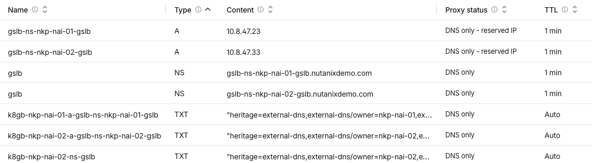

# k8gb — Global Server Load Balancing on Kubernetes

> A standalone guide to setting up and testing k8gb GSLB across two Kubernetes clusters.

## What is k8gb?

[k8gb](https://www.k8gb.io) is a CNCF sandbox project that provides **Global Server Load Balancing (GSLB)** for Kubernetes. It uses:

- **CoreDNS** as the in-cluster DNS server serving a delegated zone
- **external-dns** to sync NS delegation records to a cloud DNS provider (Cloudflare, Route53, etc.)
- **Gslb CRDs** to define failover/round-robin policies across clusters
- **GeoTags** to identify clusters and determine primary/secondary roles

## Prerequisites

- Two Kubernetes clusters (e.g., `dc01` and `dc02`)
- A Cloudflare DNS zone (parent zone, e.g. `example.com`)
- A Cloudflare API token with DNS edit permissions
- LoadBalancer with 2 free IPs on each cluster
- Helm 3 and kubectl installed
- NKP 2.19 / K8s 1.36+ (or any K8s 1.32+)

## Architecture Overview

For this guide, we will deploy an NGINX web server as our sample app (test-gslb-app) with a corresponding service (test-gslb-svc) configured with an external IP.

```
┌──────────────────────────────────────────────────────────────────────────────────┐
│                        Cloudflare DNS (parent zone)                              │
│  gslb.nutanixdemo.com → NS gslb-ns-dc01 (IP address of dc01 CoreDNS service)     │
│                         NS gslb-ns-dc02 (IP address of dc02 CoreDNS service)     │
└──────────────────────┬─────────────────────┬─────────────────────────────────────┘
                       │                     │
          ┌────────────▼───────┐    ┌────────▼────────────┐
          │  dc01 (Primary)    │    │  dc02 (Secondary)   │
          │                    │    │                     │
          │  k8gb Controller   │◄──►│  k8gb Controller    │
          │  CoreDNS (LB)      │    │  CoreDNS (LB)       │
          │  external-dns      │    │  external-dns       │
          │                    │    │                     │
          │  test-gslb-app     │    │  test-gslb-app      │
          │  test-gslb-svc (LB)│    │  test-gslb-svc (LB) │
          └────────────────────┘    └─────────────────────┘
```

## Installation

### Step 1: Create Namespace (on BOTH clusters)

```bash
kubectl --kubeconfig dc01.yaml create namespace k8gb
kubectl --kubeconfig dc02.yaml create namespace k8gb
```

### Step 2: Create Cloudflare Secret (on BOTH clusters)

```bash
kubectl --kubeconfig dc01.yaml create secret generic cloudflare -n k8gb \
  --from-literal=cloudflare_api_token=<YOUR_CF_API_TOKEN>

kubectl --kubeconfig dc02.yaml create secret generic cloudflare -n k8gb \
  --from-literal=cloudflare_api_token=<YOUR_CF_API_TOKEN>
```

### Step 3: Add Helm Repository (one-time, local)

```bash
# This is a local operation — only needs to be done once on your workstation
helm repo add k8gb https://www.k8gb.io
helm repo update
```

### Step 4: Create Values File

Create a `values-dc01.yaml` (and a separate one for dc02):

```yaml
# values-dc01.yaml
k8gb:
  installLegacyCrds: false
  clusterGeoTag: dc01
  extGslbClustersGeoTags: dc02

  reconcileRequeueSeconds: 10
  nsRecordTTL: 60

  dnsZones:
    - loadBalancedZone: gslb.example.com
      parentZone: example.com

extdns:
  enabled: true

  provider:
    name: cloudflare

  interval: 20s

  domainFilters:
    - example.com

  txtPrefix: k8gb-dc01-
  txtOwnerId: dc01

  env:
    - name: CF_API_TOKEN
      valueFrom:
        secretKeyRef:
          name: cloudflare
          key: cloudflare_api_token

coredns:
  serviceType: LoadBalancer
```

For dc02, swap `dc01` ↔ `dc02` in `clusterGeoTag`, `extGslbClustersGeoTags`, `txtPrefix`, and `txtOwnerId`.

### Step 5: Install on Both Clusters

Each `helm install` targets a specific cluster via `--kubeconfig`:

```bash
# Cluster A
helm install k8gb k8gb/k8gb --version 1.0.1 \
  -n k8gb -f values-dc01.yaml \
  --kubeconfig dc01.yaml

# Cluster B
helm install k8gb k8gb/k8gb --version 1.0.1 \
  -n k8gb -f values-dc02.yaml \
  --kubeconfig dc02.yaml
```

> **Note:** `helm repo add` (Step 3) is a one-time local operation stored in `~/.cache/helm`.
> Only `helm install`/`helm uninstall` need `--kubeconfig` to target a specific cluster.

### Step 6: Remove CoreDNS Probes (Post-Install)

k8gb's CoreDNS liveness/readiness probes must be removed because the health/ready
plugins aren't active until dynamic zone config is generated:

```bash
# Cluster A
kubectl --kubeconfig dc01.yaml patch deployment k8gb-coredns -n k8gb --type json \
  -p '[{"op":"remove","path":"/spec/template/spec/containers/0/livenessProbe"},
       {"op":"remove","path":"/spec/template/spec/containers/0/readinessProbe"}]'

# Cluster B
kubectl --kubeconfig dc02.yaml patch deployment k8gb-coredns -n k8gb --type json \
  -p '[{"op":"remove","path":"/spec/template/spec/containers/0/livenessProbe"},
       {"op":"remove","path":"/spec/template/spec/containers/0/readinessProbe"}]'
```

Restart CoreDNS after patching:

```bash
kubectl --kubeconfig dc01.yaml rollout restart deployment k8gb-coredns -n k8gb
kubectl --kubeconfig dc02.yaml rollout restart deployment k8gb-coredns -n k8gb
```

## How GSLB Works

### Normal Operation (dc01 = Primary, dc02 = Secondary)

1. **Both clusters** run k8gb controllers that monitor each other's health via CoreDNS queries
2. k8gb creates two **DNSEndpoints** per cluster (see [DNSEndpoints](#dnsendpoints) section above):
   - `extdns` type in `k8gb` namespace → NS delegation, synced to Cloudflare by external-dns
   - `local` type in app namespace → GSLB A records, served by CoreDNS via `k8s_crd` plugin
3. **dc01 (primary)** serves `test-gslb.gslb.example.com → <dc01-service-ip>` via its local DNSEndpoint
   > *Note: `<dc01-service-ip>` is the LoadBalancer IP of `test-gslb-svc`, which is created when the test app is deployed (see [Test App Configs](#test-app-configs) below). Until then, the Gslb CR references the service but no IP is assigned yet.*
4. **dc02 (secondary)** also serves the same record (pointing to dc01) while dc01 is healthy
   > *Note: dc02's local DNSEndpoint initially targets dc01's service IP. dc02's own service IP (`<dc02-service-ip>`) is only used during failover.*
5. **external-dns** on both clusters syncs **NS delegation records** to Cloudflare (from the extdns DNSEndpoint):
   - `gslb.example.com NS gslb-ns-dc01-gslb.example.com → <dc01-coredns-ip>`
   - `gslb.example.com NS gslb-ns-dc02-gslb.example.com → <dc02-coredns-ip>`
6. **External clients** query Cloudflare → get NS records → query CoreDNS directly → get service IP

> **Important:** `test-gslb.gslb.example.com` is a **local record** served by CoreDNS, NOT a Cloudflare record. Only the NS delegation is in Cloudflare.
>
> **Timing note:** The service IP (`<dc01-service-ip>` / `<dc02-service-ip>`) referenced above does not exist until the test app and its `test-gslb-svc` LoadBalancer are deployed (see [Test App Configs](#test-app-configs)). k8gb will reconcile the local DNSEndpoint with the actual IP once the service is available.



*Example of the Cloudflare records that get created*

For an explanation of the Cloudflare records that get created, see the [Appendix](#appendix-cloudflare-dns-records).

### Failover (dc01 goes down)

1. **dc01 becomes unreachable**
2. **dc02's controller** queries dc01's CoreDNS → times out → marks dc01 unhealthy
3. **dc02's k8gb** reconciles the Gslb CR — updates the local DNSEndpoint (changes targets to dc02's IP)
4. **dc02's CoreDNS** now serves `test-gslb.gslb.example.com → <dc02-service-ip>` (reads updated DNSEndpoint via k8s_crd)
   > *Note: `<dc02-service-ip>` is dc02's `test-gslb-svc` LoadBalancer IP, which exists once the test app is deployed on dc02.*
5. **No Cloudflare update needed** — NS records are unchanged
6. **External clients** that hit dc01's CoreDNS time out and retry via dc02's CoreDNS → get dc02's IP

## DNSEndpoints

k8gb creates **DNSEndpoint** CRs (from external-dns) that bridge k8gb's internal state to external DNS providers and CoreDNS. There are two types, created at different points in the lifecycle.

### Two Types of DNSEndpoints

| Type | Namespace | Label | Purpose | Synced to Cloudflare? | Created When |
|------|-----------|-------|---------|----------------------|--------------|
| **NS Delegation** | `k8gb` | `dnstype: extdns` | Delegates `gslb.example.com` zone to CoreDNS IPs | Yes | Immediately after k8gb Helm install, when the controller starts |
| **Local GSLB** | application ns (e.g. `default`) | `dnstype: local` | Serves GSLB A records via CoreDNS (owned by Gslb CR) | No (CoreDNS only) | When a Gslb CR is applied (before the app/service exists) |

### NS Delegation DNSEndpoint (k8gb namespace)

Created automatically by the k8gb controller **immediately after Helm install** (before any Gslb CR exists). Contains NS records for the parent zone and A records for each CoreDNS service:

```yaml
# k8gb-ns-extdns-gslb-example-com (in k8gb namespace)
apiVersion: externaldns.k8s.io/v1alpha1
kind: DNSEndpoint
metadata:
  name: k8gb-ns-extdns-gslb-example-com
  namespace: k8gb
  labels:
    k8gb.io/dnstype: extdns
spec:
  endpoints:
    # NS delegation: parent zone -> CoreDNS service hostnames
    - dnsName: gslb.example.com
      recordType: NS
      recordTTL: 60
      targets:
        - gslb-ns-dc01-gslb.example.com
        - gslb-ns-dc02-gslb.example.com
    # A record: CoreDNS service hostname -> LoadBalancer IP
    - dnsName: gslb-ns-dc01-gslb.example.com
      recordType: A
      recordTTL: 60
      targets:
        - 10.8.47.23   # dc01 CoreDNS LB IP
```

**Timeline:** k8gb controller starts → creates this DNSEndpoint within seconds → external-dns picks it up on its next sync interval (default 20s) → NS records appear in Cloudflare.

### Local GSLB DNSEndpoint (application namespace)

Created by the k8gb controller **when a Gslb CR is applied** (step 4 in the [Creation Order Summary](#creation-order-summary) above — before the test app is deployed). Owned by the Gslb resource (deleted when Gslb is deleted).

> **Note:** The DNSEndpoint is created as soon as the Gslb CR is applied, even if the referenced `test-gslb-svc` Service does not exist yet. Its `targets` (service IP) will be empty/unresolved until the Service is created and receives a LoadBalancer IP. k8gb continuously reconciles and populates the IP once the Service becomes available.

```yaml
# test-gslb (in default namespace)
apiVersion: externaldns.k8s.io/v1alpha1
kind: DNSEndpoint
metadata:
  name: test-gslb
  namespace: default
  labels:
    k8gb.io/dnstype: local
  ownerReferences:
    - apiVersion: k8gb.io/v1beta1
      kind: Gslb
      name: test-gslb
spec:
  endpoints:
    # Internal: peer cluster queries this to check health
    - dnsName: localtargets.test-gslb.gslb.example.com
      recordType: A
      recordTTL: 30
      targets:
        - 10.8.47.24   # dc01 service IP
    # Internal: alternate form
    - dnsName: localtargets-test-gslb.gslb.example.com
      recordType: A
      recordTTL: 30
      targets:
        - 10.8.47.24
    # The actual GSLB record served by CoreDNS
    - dnsName: test-gslb.gslb.example.com
      recordType: A
      recordTTL: 30
      targets:
        - 10.8.47.24
      labels:
        strategy: failover
```

**Timeline:** Gslb CR applied → k8gb controller reconciles → creates local DNSEndpoint → CoreDNS `k8s_crd` plugin reads it → GSLB A record is served. On failover, k8gb updates this DNSEndpoint's targets and CoreDNS serves the new IP within seconds.

> This DNSEndpoint is **not** synced to Cloudflare. CoreDNS reads it via the `k8s_crd` plugin and serves the record directly.

### Creation Order Summary

```
1. helm install k8gb          → CRDs, controllers, CoreDNS, external-dns deployed
2. k8gb controller starts     → creates extdns DNSEndpoint (NS delegation) in k8gb ns
3. external-dns syncs (20s)   → NS records appear in Cloudflare
4. kubectl apply Gslb CR      → creates local DNSEndpoint in app namespace
5. CoreDNS reads DNSEndpoint  → GSLB A record served via k8s_crd plugin
6. kubectl apply test app     → service gets LoadBalancer IP (this is when <dc01-service-ip> / <dc02-service-ip> first exist)
7. k8gb reconciles health     → updates local DNSEndpoint targets with the now-available service IP
```

## Test App Configs


### Test Application (deploy on BOTH clusters)

```yaml
# test-gslb-app.yaml
apiVersion: apps/v1
kind: Deployment
metadata:
  name: test-gslb-app
  namespace: default
spec:
  replicas: 2
  selector:
    matchLabels:
      app: test-gslb-app
  template:
    metadata:
      labels:
        app: test-gslb-app
    spec:
      containers:
        - name: nginx
          image: nginx:1.27-alpine
          ports:
            - containerPort: 80
---
apiVersion: v1
kind: Service
metadata:
  name: test-gslb-svc
  namespace: default
  labels:
    app: test-gslb-app
spec:
  type: LoadBalancer
  selector:
    app: test-gslb-app
  ports:
    - name: http
      port: 80
      protocol: TCP
      targetPort: 80
```

Apply on both clusters:
```bash
kubectl --kubeconfig dc01.yaml apply -f test-gslb-app.yaml
kubectl --kubeconfig dc02.yaml apply -f test-gslb-app.yaml
```

### Gslb Resource (deploy on BOTH clusters)

```yaml
# test-gslb.yaml
apiVersion: k8gb.io/v1beta1
kind: Gslb
metadata:
  name: test-gslb
  namespace: default
  annotations:
    k8gb.io/hostname: test-gslb.gslb.example.com
spec:
  resourceRef:
    apiVersion: v1
    kind: Service
    name: test-gslb-svc
  strategy:
    type: failover
    primaryGeoTag: dc01
```

Apply on both clusters:
```bash
kubectl --kubeconfig dc01.yaml apply -f test-gslb.yaml
kubectl --kubeconfig dc02.yaml apply -f test-gslb.yaml
```
> **Note:** Both Gslb configs are identical, as `primaryGeoTag` should match the geo tag of your primary cluster.

## Verification

```bash
# Check Gslb status on both clusters
kubectl --kubeconfig dc01.yaml get gslb test-gslb -n default -o jsonpath='{.status}' | python3 -m json.tool
kubectl --kubeconfig dc02.yaml get gslb test-gslb -n default -o jsonpath='{.status}' | python3 -m json.tool

# Check DNSEndpoints
# extdns type (in k8gb ns) — NS delegation, synced to Cloudflare
kubectl --kubeconfig dc01.yaml get dnsendpoints -n k8gb
kubectl --kubeconfig dc02.yaml get dnsendpoints -n k8gb

# local type (in default ns) — GSLB A records, served by CoreDNS
kubectl --kubeconfig dc01.yaml get dnsendpoints -n default
kubectl --kubeconfig dc02.yaml get dnsendpoints -n default

# Query CoreDNS directly from each cluster
COREDNS_IP_DC01=$(kubectl --kubeconfig dc01.yaml get svc k8gb-coredns -n k8gb -o jsonpath='{.status.loadBalancer.ingress[0].ip}')
APP_POD_DC01=$(kubectl --kubeconfig dc01.yaml get pod -n default -l app=test-gslb-app -o jsonpath='{.items[0].metadata.name}')
kubectl --kubeconfig dc01.yaml exec $APP_POD_DC01 -n default -- nslookup test-gslb.gslb.example.com $COREDNS_IP_DC01

COREDNS_IP_DC02=$(kubectl --kubeconfig dc02.yaml get svc k8gb-coredns -n k8gb -o jsonpath='{.status.loadBalancer.ingress[0].ip}')
APP_POD_DC02=$(kubectl --kubeconfig dc02.yaml get pod -n default -l app=test-gslb-app -o jsonpath='{.items[0].metadata.name}')
kubectl --kubeconfig dc02.yaml exec $APP_POD_DC02 -n default -- nslookup test-gslb.gslb.example.com $COREDNS_IP_DC02
```

## Test Failover

From your workstation, run nslookup on the Gslb record `test-gslb.gslb.example.com`

```
nslookup test-gslb.gslb.example.com
```

This should point to the external IP of `test-gslb-svc` on the primary side (dc01).

Scale down the app on the primary side:
```
kubectl --kubeconfig dc01.yaml scale deploy test-gslb-app --replicas=0
```
The k8gb controller on the secondary site will mark dc01 as unhealthy and will publish dc02's IP as the active record, and nslookup should now point to the external IP of `test-gslb-svc` on the secondary site (dc02).

## Diagrams

- [k8gb GSLB — Normal Operation & Failover](../html/k8gb-combined.html) — combined view with both normal and failover states
- [k8gb GSLB with DNSEndpoints](../html/k8gb-dnsendpoints.html) — normal view showing DNSEndpoint CRs

## Known Issues & Troubleshooting

### Stale Cloudflare DNS record
A pre-existing `gslb.example.com` record in Cloudflare pointing to an old IP caused cross-cluster DNS resolution failures.

**Fix:** Delete the stale record in Cloudflare → restart k8gb on both clusters → wait 60s → verify.

### CoreDNS not serving zone
Restart CoreDNS pods to pick up zone delegation ConfigMap:
```bash
kubectl --kubeconfig dc01.yaml rollout restart deployment k8gb-coredns -n k8gb
kubectl --kubeconfig dc02.yaml rollout restart deployment k8gb-coredns -n k8gb
```

## Cleanup

```bash
# Remove Gslb resources
kubectl --kubeconfig dc01.yaml delete gslb test-gslb -n default
kubectl --kubeconfig dc02.yaml delete gslb test-gslb -n default

# Remove test app
kubectl --kubeconfig dc01.yaml delete -f test-gslb-app.yaml
kubectl --kubeconfig dc02.yaml delete -f test-gslb-app.yaml

# Uninstall k8gb
helm uninstall k8gb -n k8gb --kubeconfig dc01.yaml
helm uninstall k8gb -n k8gb --kubeconfig dc02.yaml
```

## Key Takeaways

1. **k8gb uses Cloudflare for NS delegation only** — the GSLB record (`test-gslb.gslb.example.com`) is served by in-cluster CoreDNS, not Cloudflare
2. **Failover doesn't require Cloudflare updates** — CoreDNS on the active cluster serves the updated record; NS records stay the same
3. **Check for stale DNS records** — a pre-existing `gslb.example.com` record in Cloudflare is a common cause of cross-cluster resolution failures
4. **GeoTags determine primary/secondary** — `clusterGeoTag` and `extGslbClustersGeoTags` must be set correctly per cluster

## Appendix: Cloudflare DNS Records

> Explanation of the DNS records created in Cloudflare by k8gb + external-dns, and who creates each one.

## Overview

When k8gb is installed on both clusters, the following happens:

1. **k8gb controller** (on each cluster) creates a **DNSEndpoint CR** (`extdns` type) in the `k8gb` namespace. This CR declares the NS delegation records and CoreDNS A records.
2. **external-dns** (on each cluster) watches the DNSEndpoint and syncs the declared records to Cloudflare. It also creates **TXT ownership records** to track which records it manages.

Only the **NS delegation records** are synced to Cloudflare. The actual GSLB A record (`test-gslb.gslb.example.com`) is served locally by CoreDNS via the `k8s_crd` plugin and never appears in Cloudflare.

## The 7 Cloudflare Records

| # | Record Type | Name | Value | Created By |
|---|-------------|------|-------|------------|
| 1 | NS | `gslb.example.com` | `gslb-ns-dc01-gslb.example.com` | external-dns on dc01 (reads DNSEndpoint) |
| 2 | NS | `gslb.example.com` | `gslb-ns-dc02-gslb.example.com` | external-dns on dc02 (reads DNSEndpoint) |
| 3 | A | `gslb-ns-dc01-gslb.example.com` | `10.8.47.23` | external-dns on dc01 (reads DNSEndpoint) |
| 4 | A | `gslb-ns-dc02-gslb.example.com` | `10.8.47.33` | external-dns on dc02 (reads DNSEndpoint) |
| 5 | TXT | `gslb.example.com` (or prefixed) | ownership token (`txtOwnerId: dc01` or `dc02`) | external-dns on dc01 and/or dc02 (ownership tracking) |
| 6 | TXT | `gslb-ns-dc01-gslb.example.com` (or prefixed) | ownership token | external-dns on dc01 |
| 7 | TXT | `gslb-ns-dc02-gslb.example.com` (or prefixed) | ownership token | external-dns on dc02 |

## Breakdown by Record Type

### NS Records (2)

One per cluster's CoreDNS hostname. Both are needed so DNS resolvers can query either CoreDNS instance for the delegated zone.

- `gslb.example.com NS gslb-ns-dc01-gslb.example.com`
- `gslb.example.com NS gslb-ns-dc02-gslb.example.com`

These are declared in the DNSEndpoint's `gslb.example.com NS` entry, which lists both targets. Each cluster's external-dns syncs this entry, but since the values are identical, Cloudflare ends up with one NS record set containing both targets.

### A Records (2)

One per CoreDNS LoadBalancer IP. These resolve the CoreDNS hostnames so resolvers can reach them after receiving the NS delegation.

- `gslb-ns-dc01-gslb.example.com A 10.8.47.23` (dc01 CoreDNS LB IP)
- `gslb-ns-dc02-gslb.example.com A 10.8.47.33` (dc02 CoreDNS LB IP)

Each A record is created by the external-dns instance on the corresponding cluster, since each cluster knows its own CoreDNS IP.

### TXT Records (3)

external-dns creates these for **ownership tracking**. Each DNS record it manages gets a corresponding TXT record (using the `txtPrefix` and `txtOwnerId` from Helm values). This lets external-dns know which records it owns and can safely update or delete.

- TXT for `gslb.example.com` — tracks ownership of the NS delegation record
- TXT for `gslb-ns-dc01-gslb.example.com` — tracks ownership of dc01's A record
- TXT for `gslb-ns-dc02-gslb.example.com` — tracks ownership of dc02's A record

With two clusters syncing, the TXT record names may include the `txtPrefix` (e.g., `k8gb-dc01-`) to avoid collisions between clusters. The `txtOwnerId` (e.g., `dc01` or `dc02`) is stored in the TXT value to identify which cluster owns the record.

## What is NOT in Cloudflare

The following records are **local only** and never sync to Cloudflare:

| Record | Type | Served By | Mechanism |
|--------|------|-----------|-----------|
| `test-gslb.gslb.example.com` | A | CoreDNS (in-cluster) | `k8s_crd` plugin reads the local DNSEndpoint |
| `localtargets.test-gslb.gslb.example.com` | A | CoreDNS (in-cluster) | Used by peer cluster for health checks |

These are stored in the **local DNSEndpoint** (created by the Gslb CR in the application namespace, labeled `dnstype: local`). CoreDNS reads this DNSEndpoint via the `k8s_crd` plugin and serves the record directly. Only the `extdns`-type DNSEndpoint (in the `k8gb` namespace) is synced to Cloudflare by external-dns.

## Key Takeaways

1. **NS delegation is the only thing in Cloudflare** — 2 NS + 2 A + 3 TXT = 7 records total.
2. **k8gb controller creates the DNSEndpoint CR** declaring what records should exist; **external-dns** is the one that actually creates them in Cloudflare.
3. **TXT records are ownership markers**, not data records. They let external-dns safely manage records across two clusters without conflicts.
4. **Failover requires no Cloudflare update** — the NS records stay the same; only the local DNSEndpoint (CoreDNS) is updated with the new service IP.
